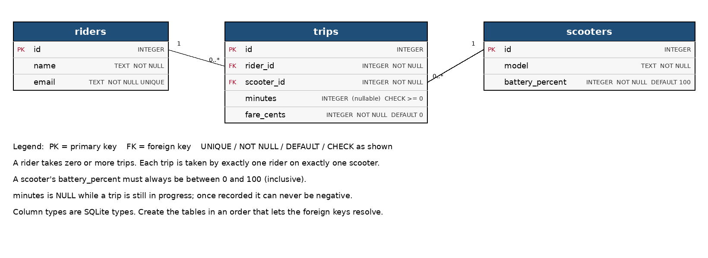

# Summative Assessment

## Learning Outcomes

| Learning Outcome | Section |
|---|---|
| Agile Methodology | Section 1 |
| Brownfields Development | Section 2 |
| Object-Oriented Programming | Section 3 |
| Systems Design | Section 4 |
| Build Pipelines / Scripting | Section 5 |
| Relational Databases | Section 6 |
| Web Development | Section 7 |

---

## Duration

**Total time: 3 hours 10 minutes**

| Section | Recommended Time |
|---|---|
| Section 1 — Agile Methodology | 15 minutes |
| Section 2 — Brownfields Development | 35 minutes |
| Section 3 — Object-Oriented Programming | 35 minutes |
| Section 4 — Systems Design | 15 minutes |
| Section 5 — Build Pipelines and Scripting | 30 minutes |
| Section 6 — Relational Databases | 30 minutes |
| Section 7 — Web Development | 30 minutes |

---

## Scoring

| Section | Marks |
|---|---|
| Section 1 — Agile Methodology | 10 |
| Section 2 — Brownfields Development | 14 |
| Section 3 — Object-Oriented Programming | 16 |
| Section 4 — Systems Design | 10 |
| Section 5 — Build Pipelines and Scripting | 16 |
| Section 6 — Relational Databases | 18 |
| Section 7 — Web Development | 16 |
| **Total** | **100** |

---

## The scenario

**ScootShare** is a start-up that rents electric scooters by the minute. Riders
unlock a scooter from an app, ride it, lock it again and are charged under a
pricing plan. The original contractor has left and your team has inherited the code
base. It mostly works, but parts are untidy, parts are untested, parts are broken and
several pieces the business needs are missing.

Written answers go in `answers.txt` under the matching question heading. **Do not
change the format of the file or create a new one.** Code answers go in the project.

> **Rules**
> - You may not modify any file under `src/test`, **except** `PromoCodeParserTest.java` (Q2.3).
> - Files marked "Provided; do not change" must be left alone.
> - Sections can be attempted in any order; each section can be completed on its own.
> - `mvn test` runs the whole suite. Expect many failures at the start. Each failing
>   test belongs to one of the tasks below.

---

# Section 1 — Agile Methodology

The ScootShare founders have asked for "everything" to be ready by launch in six
months. You have been asked to introduce Scrum.

| Task | Marks | What earns marks |
|---|---|---|
| Q1.1 — Scrum roles and events | 4 | The three roles and what each is accountable for (2), the four events named correctly with their purpose (2) |
| Q1.2 — Splitting an epic | 3 | Three stories that are each a thin, working, end-to-end slice rather than a technical layer (2), one INVEST property correctly explained against the split (1) |
| Q1.3 — Sprint planning | 3 | A selection that fits within the velocity (1), a justification based on priority and a sprint goal (1), what happens to the remaining stories and what "done" means (1) |

---

### Q1.1 — Scrum roles and events *(4 marks)*

Name the three Scrum roles and say what each is accountable for. Then name the four
Scrum events and give the purpose of each in one sentence.

### Q1.2 — Splitting an epic *(3 marks)*

The epic is: **"A rider can rent a scooter and pay for the trip."**

Split it into **three** user stories ("As a … I want … so that …") that could each be
built, tested and demonstrated on their own. Say which INVEST property your split
satisfies best, and why.

### Q1.3 — Sprint planning *(3 marks)*

The team's velocity is **18 story points** per sprint. The Product Owner's ordered
backlog (highest priority first) is:

| # | Story | Points |
|---|---|---|
| 1 | Rider sign-up | 3 |
| 2 | Unlock a scooter | 8 |
| 3 | Pay for a trip | 5 |
| 4 | Low-battery warning | 5 |
| 5 | Trip history | 3 |
| 6 | Promo codes | 2 |

Choose the stories for the next sprint and justify the choice. Say what happens to
the stories you did not select, and what must be true of a selected story before
the team may call it finished.

---

# Section 2 — Brownfields Development

| Task | Marks | What earns marks |
|---|---|---|
| Q2.1 — Working in a brownfield | 3 | Accurate definition (1), two genuine challenges (1), one concrete strategy that reduces the risk (1) |
| Q2.2 — Characterisation tests | 3 | What a characterisation test is and how it differs from an ordinary test (2), why they come before a refactor or change (1) |
| Q2.3 — Characterise `PromoCodeParser` | 4 | At least 6 tests, all passing against the current code (1), null / blank / case and whitespace handling covered (1), the boundaries of the `SCOOT` range covered (1), at least one undocumented quirk found, tested and recorded in `answers.txt` (1) |
| Q2.4 — Refactoring for maintainability | 4 | Per method (2 each): smell correctly identified and explained (1), refactor removes it, existing tests pass unmodified, and the justification refers to the student's own change (1) |

---

### Q2.1 — Working in a brownfield *(3 marks)*

Define brownfield development. Give two challenges of working in a brownfield
code base, and one concrete strategy a team can use to reduce the risk of changing
it.

### Q2.2 — Characterisation tests *(3 marks)*

What is a characterisation test, and how does it differ from a normal unit test?
Why are they written before you refactor or change legacy code?

### Q2.3 — Characterise `PromoCodeParser` *(4 marks)*

`PromoCodeParser.discountPercent` turns a code typed by a rider into a discount. It
was written years ago, has no tests, and nobody remembers every rule. **Do not change
the class.** Write characterisation tests for it in `PromoCodeParserTest.java`
(the one test file you may edit). Every test must pass against the code as it is.

List every rule you discovered in `answers.txt`, including any behaviour you believe
is a bug.

### Q2.4 — Refactoring for maintainability *(4 marks)*

Two methods in `src/main/java/.../service/` have maintainability problems in how
their logic is written. They are **covered by tests that pass today**. For each:

1. Identify the method and the code smell, and explain why it matters *(Q2.4.1)*.
2. Refactor it so that the smell is gone. The tests must still pass, unmodified.
3. Write 3 to 5 sentences on why the new structure is more maintainable *(Q2.4.2)*.

> Refactoring means the behaviour must not change. If a test that passed now fails,
> your refactor changed behaviour.

---

# Section 3 — Object-Oriented Programming

| Task | Marks | What earns marks |
|---|---|---|
| Q3.1 — Encapsulate `Rider` | 4 | Fields private, `name` and `email` final (1), constructor validates and normalises (1), defensive copy and no mutation through the getter (1), `equals` / `hashCode` on email (1) |
| Q3.2 — Pricing strategies | 6 | `PayPerMinute` (1), `DayPass` (1), `PricingStrategies.forPlan` (2), written explanation of the pattern and of adding a new plan (2) |
| Q3.3 — `CargoScooter` | 6 | Extends `ElectricScooter` using the existing constructor (1), speed and drain values (2), `maxLoadKg` (1), `describe` built on `super.describe()` rather than copied (2) |

---

### Q3.1 — Encapsulate `Rider` *(4 marks)*

`Rider` exposes its state to the world. Fix it so that `RiderTest` passes:

- every field is private, and `name` and `email` can never be reassigned;
- the constructor rejects a null or blank name or email (`IllegalArgumentException`)
  and stores the name trimmed and the email trimmed and lower-cased;
- `addTrip` rejects a null or blank id;
- `getTripIds()` hands out a read-only snapshot, so callers can neither change the
  rider's list nor see later changes through an old reference;
- two riders with the same email are equal.

Name two distinct problems with the original class, and the bug each makes possible,
in `answers.txt`.

### Q3.2 — Pricing strategies *(6 marks)*

`TripPricer` (provided) quotes a fare using whatever `PricingStrategy` it is given.
Complete the pricing code so that `PricingStrategiesTest` passes:

| Plan | Name | Price |
|---|---|---|
| Pay per minute | `PAY_PER_MINUTE` | R5.00 unlock fee + R1.50 per minute |
| Day pass | `DAY_PASS` | R40.00 flat for up to 240 minutes, then R1.00 per extra minute |

`PricingStrategies.forPlan(String)` returns the matching strategy, ignoring case and
surrounding spaces, and throws `IllegalArgumentException("Unknown plan: ...")` for
anything else (including `null`).

In `answers.txt`, name the design pattern, say why it beats an if/else chain inside
`TripPricer`, and say exactly what you would change to add a `WEEKLY_PASS` plan.

### Q3.3 — `CargoScooter` *(6 marks)*

Complete `CargoScooter` so that `CargoScooterTest` passes. It is an
`ElectricScooter` with a maximum speed of `15` km/h, a battery drain of `4.0` percent
per kilometre, and a maximum load of `100` kg (`maxLoadKg()`).

Its `describe()` must return the inherited description followed by
`" (cargo, max load 100 kg)"`, e.g. `CargoScooter C1 battery=80% (cargo, max load 100 kg)`.
Do not duplicate the parent's logic.

---

# Section 4 — Systems Design

| Task | Marks | What earns marks |
|---|---|---|
| Q4.1 — Layered architecture | 4 | Three layers identified from the project's packages (1), the responsibility of each (1), one concrete benefit of the separation (1), one thing a layer must *not* do, with an example from ScootShare (1) |
| Q4.2 — Sequence diagram | 6 | Correct participants (2), messages in the right order with returns (2), the three failure branches shown with `alt` (or equivalent) (2) |

---

### Q4.1 — Layered architecture *(4 marks)*

ScootShare's packages are `web`, `service`/`model` and `db`. Identify the layers they
represent and say what each is responsible for. Give one benefit of keeping them
separate and one thing a layer must *not* do, using ScootShare as your example.

### Q4.2 — Sequence diagram *(6 marks)*

Draw a **sequence diagram** (Mermaid `sequenceDiagram` or PlantUML text in
`answers.txt`) for **"A rider unlocks a scooter"** using the rules in the Javadoc of
`ScooterApi`. Show the client, `ScooterApi`, `ScooterStore` and the scooter, and the
three ways the request can fail as well as the success path.

---

# Section 5 — Build Pipelines and Scripting

`make package` builds a jar and runs it. At the moment it does not work, and the
pipeline is unfinished.

| Task | Marks | What earns marks |
|---|---|---|
| Q5.1 — Versions, artifacts and pipelines | 3 | What MAJOR.MINOR.PATCH each mean (1), what a build artifact is and why the pipeline builds once (1), why the pipeline runs on every push but packaging is limited to the default branch (1) |
| Q5.2 — Fix the build | 4 | Missing main class fixed (1), wrongly scoped dependency fixed (1), `make package` produces a jar that runs with `java -jar` (1), both faults and their errors explained (1) |
| Q5.3 — Build a pipeline | 5 | `stages` in the right order (1), `test` job in its own stage (1), JUnit report published as a test report (1), `package` job only on the default branch (1), the jar kept as an artifact (1) |
| Q5.4 — Script a version bump | 4 | `patch`, `minor` and `major` bump correctly (2), prints `old -> new` and rewrites only the project's own version (1), error handling and exit statuses (1) |

---

### Q5.1 — Versions, artifacts and pipelines *(3 marks)*

What do the three parts of a semantic version (MAJOR.MINOR.PATCH) mean? What is a
build artifact, and why does a pipeline build it once rather than rebuild it for
each environment? Why should the pipeline run on every push, yet the packaging job
only on the default branch?

### Q5.2 — Fix the build *(4 marks)*

Run `make package`, then run the jar with `java -jar`. It fails, and fixing the first
error reveals a second. Find both faults in `pom.xml`, fix them, and explain each in
`answers.txt`: the error it produced and why your change cures it.

> `sqlite-jdbc` is needed while the application runs, not only while it is tested.

### Q5.3 — Build a pipeline *(5 marks)*

The image and the `compile` job in `.gitlab-ci.yml` are provided. Define the `stages`
and add:

- a `test` job in a `test` stage that runs `make test` and publishes the Surefire XML
  reports (`target/surefire-reports/TEST-*.xml`) as a **JUnit test report**, even when
  tests fail;
- a `package` job in a `package` stage that runs `make package`, **only on the
  default branch**, and keeps the built jar as an artifact.

> See the [GitLab CI/CD YAML reference](https://docs.gitlab.com/ci/yaml/) for `rules`
> and `artifacts:reports`.

### Q5.4 — Script a version bump *(4 marks)*

Complete `scripts/bump-version.sh` following the instructions in its header. Check
your work with:

```bash
bash scripts/check-bump.sh
```

---

# Section 6 — Relational Databases

`resources/erd.png` is the entity relationship diagram for ScootShare. A `Database`
class that opens a SQLite connection (with foreign keys switched on) is provided.



> `resources/SQL-Cheat-Sheet.pdf` is provided for reference.

| Task | Marks | What earns marks |
|---|---|---|
| Q6.1 — Normalisation | 4 | The functional dependencies in the flat table identified (1), the anomalies they cause named with an example of each (2), a correct decomposition (1) |
| Q6.2 — Create the schema | 6 | Correct tables, columns and types (2), keys with `NOT NULL` / `UNIQUE` (1), `DEFAULT` and both `CHECK` constraints (2), both foreign keys (1) |
| Q6.3 — Query the data | 8 | `findScooterIdsRiddenBy`: join, `DISTINCT`, ordered, parameterised (3); `findRidersWithNoTrips`: a correct anti-join or `NOT EXISTS`, ordered (2); `totalMinutesPerModel`: join, `GROUP BY` and a parameterised `HAVING` (3) |

---

### Q6.1 — Normalisation *(4 marks)*

Before the redesign, all trip data lived in a single table:

| trip_id | rider_name | rider_email | scooter_model | scooter_battery | minutes |
|---|---|---|---|---|---|
| 1 | Zanele Khumalo | zanele@mail.co.za | Standard | 80 | 10 |
| 2 | Zanele Khumalo | zanele@mail.co.za | Cargo | 40 | 30 |
| 3 | Pieter van Wyk | pieter@mail.co.za | Standard | 80 | 15 |

Identify the functional dependencies that make this design poor, name the update,
insert and delete anomalies it causes (give an example of each from this data), and
show how the ERD removes them.

### Q6.2 — Create the schema *(6 marks)*

Implement `DatabaseSchema.createSchema(Connection connection)` so that it creates the
`riders`, `scooters` and `trips` tables exactly as shown in the ERD, including every
`NOT NULL`, `UNIQUE`, `DEFAULT` and `CHECK` constraint. `DatabaseSchemaTest` checks
your work.

### Q6.3 — Query the data *(8 marks)*

Implement the three methods of `TripRepository` using JDBC and SQL. Values supplied
by the caller must be passed as query parameters, never concatenated into the SQL.
`TripRepositoryTest` checks your work.

---

# Section 7 — Web Development

`ScooterApi` holds the routing rules of the ScootShare web API; `ScooterServer`
(provided) exposes it over real HTTP. The exact rules, including the JSON format,
are in the Javadoc of `ScooterApi`. `QueryString` (provided) reads query parameters
and `ScooterStore` (provided) holds the fleet.

| Task | Marks | What earns marks |
|---|---|---|
| Q7.1 — HTTP and REST | 4 | A correct status code and reason for each situation (3), path vs query parameter explained (1) |
| Q7.2 — Implement the API | 8 | List and `minBattery` filter (2), get one scooter (1), unlock with its three failures in the right order (2), lock (1), 405 and 404 fallbacks (1), works over HTTP in `ScooterServerTest` (1) |
| Q7.3 — Responsive CSS | 4 | Flexbox or grid layout (1), media queries for the three layouts (1), the `low-battery` modifier (1), hover and keyboard-focus states (1) |

---

### Q7.1 — HTTP and REST *(4 marks)*

**(a)** Which status code does the API return, and why, in each situation?

1. A client unlocks a scooter that someone else is already riding.
2. A client unlocks a scooter whose battery is at 12%.
3. A client requests `GET /scooters?minBattery=lots`.
4. A client sends `DELETE /scooters/S1`.

**(b)** `GET /scooters/S1` and `GET /scooters?minBattery=50` both carry information in
the URL. When should information go in the path and when in the query string?

### Q7.2 — Implement the API *(8 marks)*

Implement `ScooterApi.route(method, path, query)` following its Javadoc. Run
`mvn test`; both `ScooterApiTest` and `ScooterServerTest` must pass.

### Q7.3 — Responsive CSS *(4 marks)*

The fleet page renders each scooter as a card:

```html
<section class="fleet">
  <article class="card">
    <h2>S1</h2>
    <p>StandardScooter</p>
    <p class="battery">80%</p>
    <button class="unlock">Unlock</button>
  </article>
  <article class="card low-battery">
    <h2>S2</h2>
    <p>StandardScooter</p>
    <p class="battery">15%</p>
    <button class="unlock">Unlock</button>
  </article>
  <!-- more cards -->
</section>
```

Write the CSS (in `answers.txt`) so that:

1. `.fleet` lays the cards out in a grid or flex row with a `1rem` gap: **one card per
   row below 600px, two from 600px, three from 900px**;
2. a card with `low-battery` has a red border, and its `.battery` text is bold and red;
3. `.unlock` changes background on hover **and** shows a clearly visible outline when
   it has keyboard focus.

---

### End of Assessment

---

## Project structure

```
scootshare/
  README.md
  answers.txt
  pom.xml
  Makefile
  .gitlab-ci.yml
  resources/
    erd.png
    SQL-Cheat-Sheet.pdf
  scripts/
    bump-version.sh
    check-bump.sh
  src/
    main/java/za/co/wethinkcode/scootshare/
      Main.java
      model/     ElectricScooter, StandardScooter, CargoScooter, Rider
      service/   PricingStrategy, PayPerMinute, DayPass, PricingStrategies, TripPricer,
                 BatteryService, FleetReport, PromoCodeParser
      db/        Database, DatabaseSchema, TripRepository
      web/       ScooterApi, ScooterServer, ScooterStore, ApiResponse, QueryString
    test/java/za/co/wethinkcode/scootshare/
      model/ service/ db/ web/
```

## Useful commands

```bash
mvn compile                 # compile the source code
mvn test                    # run the test suite
mvn package -DskipTests     # package the application into a jar
java -jar target/scootshare-jar-with-dependencies.jar
bash scripts/check-bump.sh  # check the version-bump script
```

The `Makefile` wraps the same commands and is what the GitLab CI pipeline runs:

```bash
make compile
make test
make package
```
